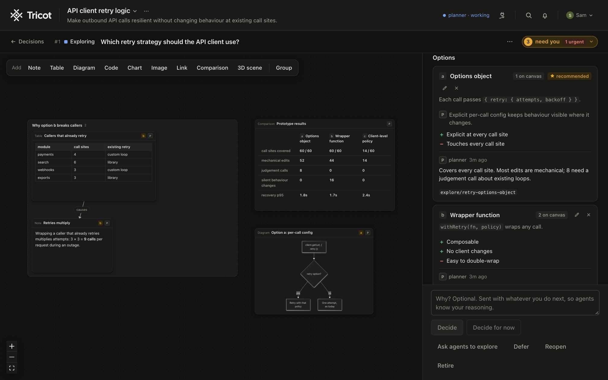

# Tricot

Tricot is a shared workspace where you and your agents plan and work together. Agents connect over MCP and bring their questions, options and workflows to the board instead of burying them in chat. You answer there, at your own pace, and the board keeps them working the way you expect: they follow what you decide, and adjust as your project changes.



## Install

Tricot is one download for every system, and needs Node 22.13 or newer. Which command to use:

- **macOS:** Homebrew, which brings Node.js along if you don't have it, or npm.
- **Linux:** npm.
- **Windows:** npm, in PowerShell or Command Prompt.

With npm, from the npm registry or straight from a [GitHub release](https://github.com/TricotStudio/tricot/releases):

```sh
# from the npm registry
npm install -g tricot

# or from a GitHub release
npm install -g https://github.com/TricotStudio/tricot/releases/download/v<version>/tricot-<version>.tgz
```

With Homebrew, on a Mac:

```sh
brew install tricotstudio/tap/tricot
```

To try it once without installing, run `npx tricot`.

### On Windows

Tricot runs on Windows, but it was built on macOS and Windows support is new. Your boards are kept in `%USERPROFILE%\.tricot`. What doesn't work there yet:

- Several agents in one terminal (`tricot claude codex`): the switcher needs a pseudo-terminal, which Windows doesn't give it today. One agent (`tricot claude`) runs on its own, without the Tricot tab or the strip at the bottom.
- Agents' requests for permission don't reach the board yet: the agent asks in its own terminal, as it does when Tricot is closed.
- `tricot update` doesn't install the update itself: it prints the commands to run.
- `tricot stop` saves your boards before it stops only when you allow it once, in the board's page (it shows a code and waits a minute). Otherwise Windows ends Tricot at once, and the last moments of work may not be saved.

## Start

```sh
tricot
```

This starts the board (or finds the one already running), opens it in your browser, and prints how to connect an agent.

Or start the board and your agent together, in one command:

```sh
tricot claude      # or: tricot codex, tricot opencode, tricot pi, tricot omp, tricot copilot
```

It asks which board to work on (`--board <id>` skips the question), opens it, and starts the agent in this terminal with the board for this session only, so the agent's own settings stay as they are. Anything after `--` goes to the agent, and when the agent quits the board stops with it, unless another agent still needs it. A board you started with `tricot` or `tricot start` keeps running; `tricot stop` ends any board.

Even one agent runs beside Tricot's own tab, with a strip at the bottom that says what it is doing: the tab opens on chat, with /threads to browse conversations and /status for your agents, requests for permission and the board's latest activity. Name several (`tricot claude codex`) and they share this terminal, one tab showing at a time, and Ctrl+\ switches ([more](docs/cli.md#several-agents-in-one-terminal)). Without a terminal, and on Windows, one agent runs on its own, without the tab or the strip.

## Connect an agent

Tricot works with any agent that speaks MCP. `tricot connect claude` (or `codex`, `pi`, `gemini`, `grok`, `copilot`) shows the agent's own command, asks, and runs it; `--print` only shows it. Or run the line for yours yourself, once, then start a new session:

```sh
# Claude Code
claude mcp add --scope user --transport http tricot "http://127.0.0.1:4545/mcp?agent=Claude"

# Codex
codex mcp add tricot --url "http://127.0.0.1:4545/mcp?agent=Codex"

# Gemini CLI
gemini mcp add --scope user --transport http tricot "http://127.0.0.1:4545/mcp?agent=Gemini"

# Pi
pi mcp add tricot --url "http://127.0.0.1:4545/mcp?agent=Pi"

# Grok Build
grok mcp add --scope user --transport http tricot "http://127.0.0.1:4545/mcp?agent=Grok"

# GitHub Copilot CLI
copilot mcp add --transport http --timeout 300000 tricot "http://127.0.0.1:4545/mcp?agent=Copilot"
```

OMP, OpenCode, Goose and Hermes Agent take it in their settings file. For OMP, in `~/.omp/agent/mcp.json`:

```json
{ "mcpServers": { "tricot": { "type": "http", "url": "http://127.0.0.1:4545/mcp?agent=OMP", "timeout": 300000 } } }
```

For OpenCode, in `~/.config/opencode/opencode.json`:

```json
{ "mcp": { "tricot": { "type": "remote", "url": "http://127.0.0.1:4545/mcp?agent=OpenCode", "timeout": 300000 } } }
```

For Goose, under `extensions` in `~/.config/goose/config.yaml` (on Windows, `%APPDATA%\Block\goose\config\config.yaml`):

```yaml
extensions:
  tricot:
    name: tricot
    type: streamable_http
    uri: "http://127.0.0.1:4545/mcp?agent=Goose"
    enabled: true
    timeout: 300
```

For Hermes Agent, under `mcp_servers` in `~/.hermes/config.yaml`:

```yaml
mcp_servers:
  tricot:
    url: "http://127.0.0.1:4545/mcp?agent=Hermes"
    timeout: 300
```

Any other MCP client connects to `http://127.0.0.1:4545/mcp` over Streamable HTTP; `tricot connect mcp-json` prints a config entry for it. `tricot connect <agent> --print` prints any of these again, and the Connect panel in Tricot shows them too.

## Learn more

- [The `tricot` command](docs/cli.md): its commands, connecting agents, showing their steps live on your boards, and updating or removing it.
- [How Tricot works](docs/how-it-works.md): how a decision moves, what agents can and can't change, tasks, and canvases.
- [MCP tools](docs/mcp-tools.md): the tools agents use, and what each one does.
- [Updates, configuration, and Google, Slack and Linear sign-in](docs/configuration.md): the daily update check, the environment variables, running Tricot on a network, connecting Google Docs, connecting Slack to read linked threads and share a decision to a channel, and connecting Linear to read issues.
- [Contributing](CONTRIBUTING.md): building and running Tricot from its source code, and how the code is laid out.

## License

Tricot is open source under the [Apache License 2.0](LICENSE), free for anyone, companies included. The licence doesn't cover the name "Tricot" or its logo: a fork needs its own. Contributions are welcome under the [CLA](CLA.md); see [CONTRIBUTING.md](CONTRIBUTING.md).

Versions 0.1.0 and 0.1.1 were released under AGPL-3.0-only; later versions are under Apache-2.0.

Copyright © 2026 Tricot Studio.

## Credits

Canvases are built on [React Flow](https://reactflow.dev) by xyflow (MIT). The wordmark is set in [Cal Sans](https://github.com/calcom/font) by Cal.com (SIL Open Font License 1.1, in `src/web/fonts/OFL.txt`).

The installed package carries `THIRD_PARTY_NOTICES.md`: the name, version and full licence of every library bundled into it, which the build writes from what the bundles hold (`scripts/notices.mjs`).
